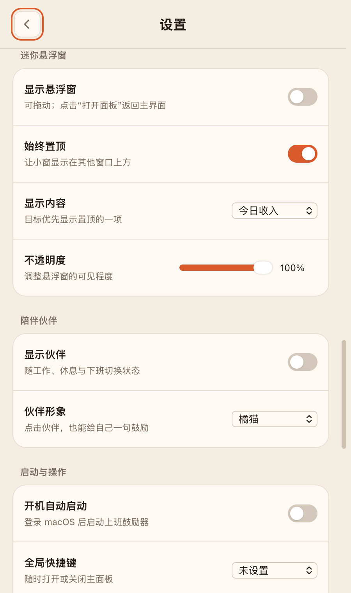

<div align="center">
  
  <h1>上班鼓励器 · Work Encourager</h1>
  <p><strong>把每一个工作日的每一分钟，折算成看得见的实时进账与生活小目标</strong></p>
  <p>
    <a href="https://caseclose.github.io/work-encourager-open/">
      
    </a>
    <a href="https://github.com/caseclose/work-encourager-open/releases/latest">
      
    </a>
    
    
  </p>
  <p>
    <a href="https://caseclose.github.io/work-encourager-open/"><strong>访问项目介绍官网 (GitHub Pages)</strong></a>
    ·
    <a href="https://github.com/caseclose/work-encourager-open/releases/latest"><strong>下载 macOS 状态栏版 (.dmg)</strong></a>
  </p>
</div>

---

## 界面预览

> 以下截图均使用虚拟演示参数与脱敏模式生成，所有真实数据仅保存在用户本机。

| 深色模式（Dark Mode） | 浅色模式（Light Mode） | 隐私脱敏模式（Privacy Mask） |
| :---: | :---: | :---: |
|  |  |  |

---

## 1.4.1 更新

新增番茄钟与树苗／星光成长反馈，支持收起、暂停恢复，以及九个模块的自由排序。查看 [完整更新说明](https://github.com/caseclose/work-encourager-open/releases/tag/v1.4.1)。


## 核心特性

### 1. 原生 macOS 顶部状态栏应用 (`NSStatusBar` + `NSPopover`)
- **常驻菜单栏跳表**：在 Mac 屏幕右上角状态栏实时显示 `¥` 徽标与今日累计收入，使用等宽数字字体（`monospacedDigitSystemFont`），数字跳动时菜单栏宽度绝不抖动。
- **九种状态栏显示**：支持收入、剩余金额、下班倒计时、工作进度、目标进度、番茄钟与自动切换等模式。
- **原生弹窗面板**：左键点击状态栏图标弹出完整仪表盘，点击外部自动收起；右键点击可快速呼出「隐藏/显示金额」「切换深色/浅色模式」「退出」快捷菜单。

### 2. 分时段计薪与进度时间轴
- **真实计薪时长折算**：支持分别勾选并扣除**午休时段**与**晚饭时段**，休息期间金额自动停表，休息结束后从已累计金额无缝续算。
- **分段式今日时间轴**：将全天班表拆分为「计薪段」与「斜纹休息段」，游标实时指示当前所处位置，并自动倒计时提示距离下一顿饭或下班还有多久。

### 3. 双层激励体系：自定义今日小目标 + 跨天大件心愿单
- **今日点亮的小目标**：把单日收入具象化成你自己的日常小物或小奖励（**默认为空**，在「设置 → 目标 → 管理目标」里添加名称、金额、Emoji、颜色和封面），实时展示解锁进度与还差多少分钟。
- **跨天大件心愿单**：结合本月已累算工作日与今日实时进账，动态折算大件心愿所需的**总工作天数、已攒百分比与剩余天数**；心愿单同样**默认为空**，由你自己添加（如手机、电脑、旅行……）。
- **「拍拍自己」即时打气**：点击按钮随机切换暖心鼓励文案，并浮现每分钟进账速率微动效。

### 4. 工位友好的三层隐私保护
- **工资与日历默认折叠**：月薪、休息方式、上下班时间与日历调休集中在右上角「设置 → 工资与日历」的折叠分组内，主面板不直接展示月薪输入框。
- **小眼睛一键全局打码**：点击右上角眼睛图标（或右键菜单栏图标），**顶部状态栏**立刻变为 `已挣 ¥***`，**面板内部**所有金额变为 `¥****` / `****`，月薪输入框变为密码圆点，同时保留百分比进度条与倒计时。
- **纯本地存储**：无数据上报，个人设置保存在本机；手动检查更新时仅请求 GitHub 公开版本信息。

### 5. 深色 / 浅色双主题
- 点击右上角太阳 / 月亮图标即可在**深咖暖金（Dark）**与**暖米羊皮纸（Light）**主题间切换，macOS 状态栏原生弹窗外观（`DarkAqua` / `Aqua`）也会同步切换。

---

## 计薪公式

```text
当月工作日   = 按「休息方式（双休 / 单休）+ 日历里的放假、补班标记」自动统计
每天计薪分钟 = (下班时间 − 上班时间) − 午休时长 − 晚饭时长
每日预计收入 = 月薪 ÷ 当月工作日
每分钟收入   = 每日预计收入 ÷ 每天计薪分钟
今天已挣金额 = 每分钟收入 × 今天已计薪分钟（精确到秒）
```

工作日不再需要手工填写：选择双休 / 单休（可指定单休的休息日）后，程序按当月日历自动统计计薪工作日，并在班表里直接显示「本月计薪工作日：N 天 · 日薪 ¥X」（打码时只显示天数）；
在「工资与日历」的日历里点击某天即可切换班/休（* 表示手动调整），当月工作日与日薪会立即重新折算；午休、晚饭在班表中为可选扣时，勾选后休息期间暂停计薪，不勾选则班内连续线性增长。

---

## 快速开始

### 方式一：直接下载 macOS 安装包（免编译，支持 Apple Silicon & Intel）

前往 [**GitHub Releases**](https://github.com/caseclose/work-encourager-open/releases/latest) 下载最新版本的安装包：

- **`WorkEncourager-macOS-universal-v1.4.1.dmg`**：双击挂载后将 `上班鼓励器.app` 拖入 `Applications` 即可。
- **`WorkEncourager-macOS-universal-v1.4.1.zip`**：解压后直接双击运行 `上班鼓励器.app`。

> 需要 macOS 13 或更新版本，安装包同时支持 Apple Silicon 与 Intel。此版本采用本地签名，尚未经过 Apple 公证；确认从本仓库下载后，可在「系统设置 → 隐私与安全性」中允许打开。Release 同时提供 SHA256 校验文件。

### 方式二：从源码编译并运行 macOS 顶部状态栏应用

要求 macOS 13.0+ 且已安装 Xcode Command Line Tools（`swiftc`）：

```bash
# 编译打包并自动安装启动 ~/Applications/上班鼓励器.app
npm run start:mac

# 生成 Universal Binary (.dmg + .zip) 发布包到 release/ 目录
npm run release:mac
```

### 方式三：作为网页应用运行

```bash
# 运行计薪与时间轴单元测试
npm test

# 启动本地静态服务器 (http://localhost:5173)
npm start
```

在浏览器中打开 [http://localhost:5173](http://localhost:5173)，点击右上角「设置」，展开「工资与日历 → 薪资、班表与日历」，填入月薪、选择休息方式与上下班时间即可开始跳表；同一分组里的日历会自动统计工作日，点日期即可调休。

### 方式四：Windows 桌面版（原生托盘应用）

Windows 版把 macOS 菜单栏应用移植为**系统托盘程序**：网页层（`index.html` 与全部 JS）原样复用，
原生外壳用 C# / WinForms + WebView2 重写，支持托盘图标与悬停状态、点击弹出面板、右键菜单、
九种显示方式、隐私打码、深色/浅色主题、迷你悬浮窗、全局快捷键（⌘⇧E → Ctrl+Shift+E）、
开机启动、系统通知、备份导入导出与检查更新。

前置条件：Windows 10/11 x64 管理员账户、[.NET 10 SDK](https://dotnet.microsoft.com/download)、
[WebView2 运行时](https://developer.microsoft.com/microsoft-edge/webview2/)（Windows 11 自带）。
Windows 版以管理员权限运行。**推荐用 MSI 安装包**（`dist/WorkEncourager-Setup-<版本>.msi`）：
安装时自动把本地代码签名证书注入受信任根/受信任发布者，并创建公共桌面与开始菜单快捷方式，
卸载会一并清理；zip 免安装版首次运行前需以管理员 PowerShell 运行一次 `trust-signing-cert.ps1`。

```powershell
# 构建 + 跑网页层单测 + 生成 dist/ 发布目录
powershell -ExecutionPolicy Bypass -File windows/build.ps1

# 构建并打包 zip（内含免安装 .NET 的自包含单文件版）
powershell -ExecutionPolicy Bypass -File windows/build.ps1 -Zip

# 构建并直接启动
powershell -ExecutionPolicy Bypass -File windows/build.ps1 -Configuration Debug -Run

# 安装到当前用户（开始菜单 + 桌面快捷方式，无需管理员）
powershell -ExecutionPolicy Bypass -File windows/install.ps1
```

产物体积：framework-dependent 版约 3 MB（需 .NET 10 桌面运行时），自包含单文件版约 50 MB（无需安装运行时）。
详见 [windows/README.md](./windows/README.md)，内含与 macOS 版的功能对照、桥接协议、数据位置与已知差异。

---

## 目录结构

```text
.
├── index.html               # 主面板结构（同时适配桌面网页、macOS 状态栏弹窗与 Windows 托盘面板）
├── styles.css               # 深色 / 浅色双主题与响应式样式
├── app.js                   # 状态同步、目标激励、隐私打码与本地持久化
├── settings.js              # 统一设置页、主题、隐私及面板显示偏好
├── goals.js                 # 目标默认值、校验与本地存储
├── goal-editor.js           # 目标新增、修改、删除与草稿保存
├── earn.js                  # 纯函数计薪核心、分段时间轴与月度累算逻辑
├── earn.test.mjs            # Node.js 单元测试套件
├── assets/                  # README 预览截图与应用图标
├── macos/
│   ├── MenuBarMain.swift    # 原生 macOS 状态栏应用 (NSStatusItem + NSPopover + WKWebView)
│   ├── generate-icon.swift  # CoreGraphics 全尺寸 Retina 应用图标生成器
│   └── build-app.sh         # 一键构建 AppIcon.icns 与 .app 应用包脚本
└── windows/
    ├── WorkEncourager/      # C# 原生外壳 (WinForms + WebView2)，复用同一套网页资源
    ├── build.ps1            # 构建 / 发布 / 打包
    ├── install.ps1          # 安装 / 卸载
    └── README.md            # Windows 版说明与 macOS 对照
```

## 1.3.0 设置与使用

[下载 v1.3.0 与阅读完整更新说明](https://github.com/caseclose/work-encourager-open/releases/tag/v1.3.0)



点击面板右上角的滑杆图标进入「设置」，左上角返回主面板。原有数据会继续保留。

- **目标个性化**：两类目标均可添加、修改、删除，设置 Emoji、颜色、本地图片封面、置顶与顺序。拖动或上移/下移后保存；置顶目标优先展示，其余按手动顺序排列。每类最多 30 项。
- **达成庆祝**：轻量动画、系统通知或静默。小目标每日、大目标每月去重；首次打开、导入已完成目标、修改价格不会重复庆祝。动画尊重系统的“减少动态效果”。
- **工资与日历（合并分组）**：薪资、休息方式、上下班时间与日历合并在「设置 → 工资与日历」一个折叠分组里。选择双休 / 单休（单休可指定休息日）后，当月计薪工作日按日历自动统计；点击任意日期即可在「班 / 休」之间切换（`*` 表示手动调整），法定节假日与调休手动标记，可一键重置本月调休。日薪 = 月薪 ÷ 当月工作日，班内连续线性增长；本月累计按含调休的班表折算。
- **菜单栏**：已挣、剩余、仅金额、下班倒计时、今日进度、目标进度、距目标所需计薪时长、随状态自动切换，共八种模式。目标优先选择置顶项。
- **提醒中心**：午休、晚饭、下班与定时活动提醒，可设置允许提醒时段及跨午夜免打扰。只在应用运行期间发送，不补发错过的通知；通知不包含薪资或金额。
- **迷你悬浮窗（macOS）**：可拖动、置顶、调整不透明度，显示收入、下班倒计时或目标进度，点击打开主面板。位置与窗口偏好会保留。
- **启动与操作（macOS）**：开机自动启动、全局快捷键（⌘⇧E 或 ⌃⌥E）、记住上次页面。通知和登录项需要 macOS 允许；失败会显示实际原因。网页中不支持的原生选项会禁用。
- **备份与恢复**：完整 JSON 备份包含薪资、班表、目标及应用偏好；“仅导出目标”不含薪资。导入先校验并显示范围，确认后替换。系统权限、登录项与快捷键不随备份导入。
- **陪伴伙伴**：可选橘猫或小芽，随计薪、休息和下班切换动态状态；点击伙伴获得一句鼓励。默认关闭。
- **更新与关于**：手动检查 GitHub 最新正式版本并打开发布页；展示版本、贡献者 Feng Wang / @caseclose 与项目链接。

主题、隐私、菜单栏、提醒和面板开关即时保存；日历调休点击即生效；目标编辑需要保存。取消或返回会放弃目标草稿。所有个人数据保存在本机，网页与 macOS 应用分别保存；仅手动检查更新时连接 GitHub，不上传薪资、班表或目标。目标封面在本机裁成 256×256 JPEG，总容量最多约 2 MB。

完整备份是可读的 JSON 文件，请自行保管。大件心愿展示的是本月收入等价进度，不是实际储蓄余额。

### 番茄钟（1.4.0）

番茄钟默认关闭，在「设置 → 番茄钟 → 显示番茄钟」开启后才会出现在主面板；开启后可开始、暂停、继续、跳过和重置番茄钟，设置中可调整专注、短休息、长休息和长休息间隔。默认 25 / 5 / 15 分钟，每 4 个番茄长休息。计时保存在本机，阶段结束后手动开始下一段，跳过不计完成。菜单栏和迷你悬浮窗均可选择番茄钟倒计时。阶段通知需开启权限，遵循允许提醒及免打扰时段；退出或睡眠期间不唤醒电脑，恢复运行后检查截止时间。完整备份包含番茄钟偏好，不包含当前计时。

番茄钟支持收起，保留计时和开始／暂停操作。设置内可选择经典倒计时、树苗成长、星光积累；完成专注会累计收获，重置本轮保留累计收获。设置 → 模块布局支持拖动排序及恢复默认顺序，布局和样式随完整备份保存。

### 1.4.1：排序化繁为简

模块布局以拖动为主，提供悬浮卡片、明确落点和平滑让位，移除重复的上下按钮。松手保存，Esc 取消；键盘可通过 Tab 聚焦手柄、空格选中、方向键移动并确认。
